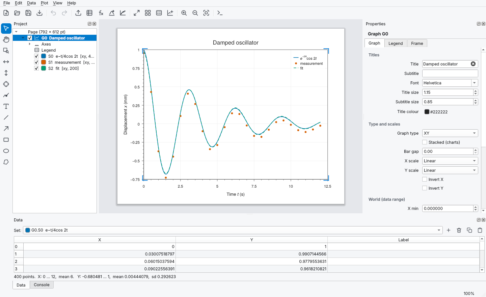
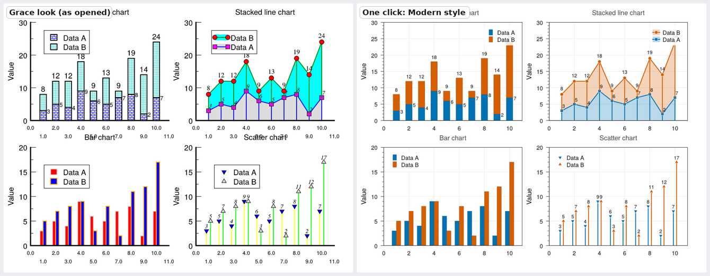
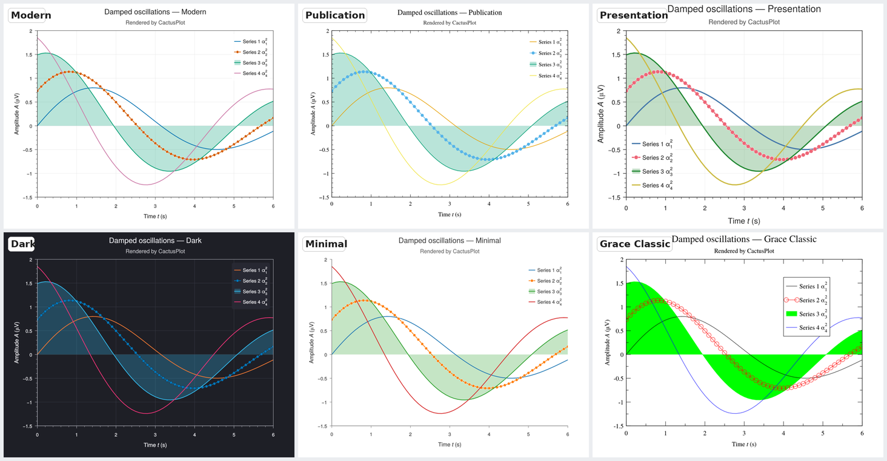
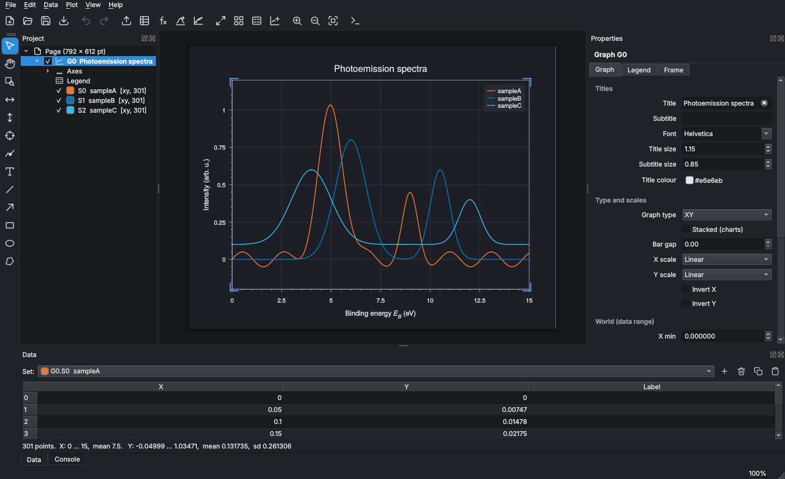
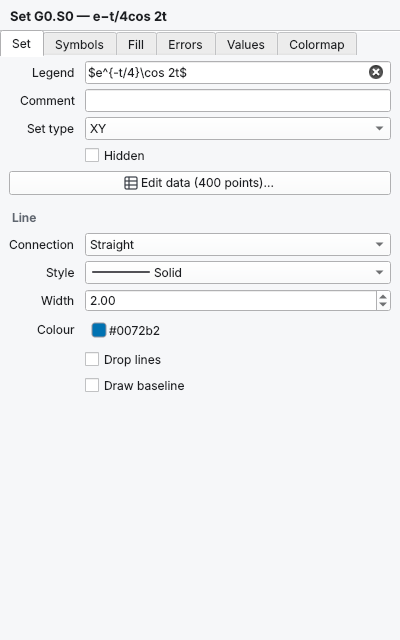
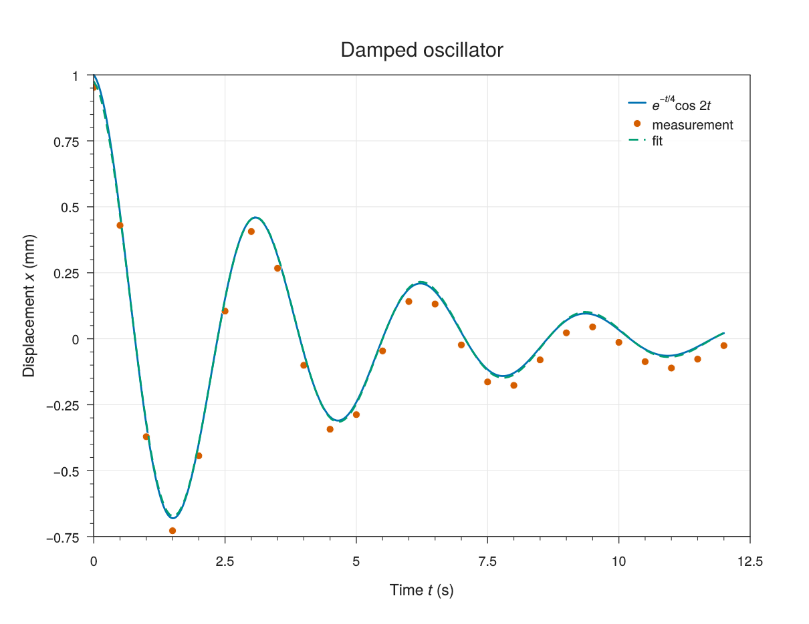

<p align="center">
  
</p>

<h1 align="center">CactusPlot</h1>

<p align="center">
  <b>Beautiful, fast 2D scientific plotting &mdash; a modern successor to XMGrace.</b><br/>
  Windows · macOS (native, no XQuartz) · Linux (X11 and Wayland) · GPL-2.0-or-later
</p>

<p align="center">
  
</p>

CactusPlot is a lightweight desktop application for making publication-quality plots. It opens and
saves **Grace/xmgrace projects**, speaks the **Grace command language**, can be driven exactly like
**gracebat** from scripts, and produces figures that look good *out of the box*.

## Highlights

- **Looks great by default.** Clean typography (bundled TeX Gyre fonts, identical on every OS), a
  light grid, colour-blind-safe colours, symbols with contrasting edges, proper minus signs and
  ×10ⁿ labels, an automatically placed legend, antialiased HiDPI rendering. Seven style presets
  (Modern, Publication, Presentation, Dark, Minimal, Journal, Grace Classic), switchable with one click.
- **Huge colour library.** ~1800 named colours (CSS, X11, xkcd, Tableau, Grace), 52 qualitative
  palettes (Okabe–Ito, Tableau, ColorBrewer, Paul Tol, Glasbey, …) and 158 colormaps (viridis
  family, cmocean, Crameri's Scientific Colour Maps, CET/colorcet, ColorBrewer), plus transparency,
  gradients and Grace's 32 fill patterns.
- **Everything Grace can do.** Multiple graphs per page, insets, all set types (XY, XYDX, XYDY,
  XYDXDY, …, BAR/BARDY, HILO, box plots, XYZ, XYR circles, XYSIZE, XYCOLOR with colormaps,
  vector maps), graph types XY, chart (stacked), polar, pie, Smith and fixed aspect, linear/log/
  reciprocal/logit scales, alternate and zero axes, every Grace tick-label format (dates, degrees,
  engineering, …), annotations with arrows, regions, rich text with Grace escapes **and** `$TeX$` math.
- **Data analysis.** Evaluate expressions (all Grace functions incl. Bessel, Airy, gamma, error,
  elliptic, zeta, Voigt …), non-linear curve fitting (bounded Levenberg–Marquardt with live preview and
  model library), regressions, FFT, histograms, interpolation and splines, running statistics,
  integration/differentiation, correlation, convolution, digital filters, pruning, sorting, …
- **Grace's personality, modern finish.** The main window is just the plot, a menu bar and a slim
  button column. Appearance, the set editor (spreadsheet) and the command window open as separate
  windows when you need them, as in xmgrace. Full undo/redo, wheel zoom and drag-to-pan, point
  editing, drawing tools, light/dark themes, drag-and-drop, copy to clipboard (PNG + SVG), autosave.
- **Exports.** PDF, SVG, EPS/PostScript (tight bounding boxes for LaTeX), PNG, JPEG, TIFF, BMP, PPM, WebP.
- **Lightweight.** C++20 and Qt 6 widgets only; the Linux package is ~2 MB.

<p align="center">
  <br/>
  <i>Grace's own <code>charts.agr</code> example opened with full fidelity (left), restyled with one click (right).</i>
</p>

<p align="center">
  
</p>

## Install

Pre-built packages are attached to every [release](https://github.com/StochasticCactus/CactusPlot/releases):

| Platform | Package |
|---|---|
| **Windows 10/11** | `CactusPlot-*-win64.exe` installer (adds file associations) or the portable `.zip` |
| **macOS 11+** (Apple silicon and Intel) | `brew install --cask stochasticcactus/tap/cactusplot`, or `CactusPlot-macOS-universal.dmg` — a native Cocoa app, no XQuartz needed |
| **Any Linux** | `CactusPlot-x86_64.AppImage` (`chmod +x` and run), works on X11 and Wayland |
| **Ubuntu, Debian, Mint, Pop!_OS** | `sudo apt install cactusplot` after adding the [apt repository](docs/install.md#ubuntu-debian-linux-mint-pop_os-apt), or `cactusplot_*_amd64.deb` |
| **Fedora, openSUSE** | `cactusplot-*.x86_64.rpm` (`sudo dnf install ./cactusplot-*.rpm`) |
| **Arch / Manjaro** | `packaging/arch/PKGBUILD` (`makepkg -si`) |
| **Flatpak (all distributions)** | `packaging/flatpak/org.cactusplot.CactusPlot.yml` |

The macOS build is ad-hoc signed. On first launch, right-click the app and choose **Open** (or run
`xattr -dr com.apple.quarantine /Applications/CactusPlot.app`).

## Build from source

Requirements: CMake ≥ 3.19, a C++20 compiler (GCC 11+, Clang 14+, MSVC 2022, Apple Clang 15) and
Qt ≥ 6.4 with the Svg and PrintSupport modules.

```bash
# Ubuntu / Debian / Mint / Pop!_OS
sudo apt install build-essential cmake ninja-build qt6-base-dev qt6-svg-dev libgl1-mesa-dev
# Fedora
sudo dnf install gcc-c++ cmake ninja-build qt6-qtbase-devel qt6-qtsvg-devel
# Arch
sudo pacman -S base-devel cmake ninja qt6-base qt6-svg
# macOS (Homebrew)
brew install cmake ninja qt
```

```bash
cmake -S . -B build -G Ninja -DCMAKE_BUILD_TYPE=Release
cmake --build build
ctest --test-dir build          # unit + GUI tests (set QT_QPA_PLATFORM=offscreen without a display)
sudo cmake --install build      # installs cactusplot, cactusbat, desktop file, icons, MIME types
```

Options: `-DCACTUS_BUILD_GUI=OFF` builds a headless, batch-only `cactusplot`;
`-DCACTUS_BUILD_TESTS=OFF` skips the tests. `cpack` creates DEB/RPM/TGZ (Linux), NSIS/ZIP
(Windows) or DMG (macOS) packages.

## Using it

Open data or projects by dragging them onto the window, with **File ▸ Open**, or from the command
line:

```bash
cactusplot data.dat                         # one set per data block
cactusplot -nxy spectra.dat                 # X Y1 Y2 ... -> one set per column
cactusplot -settype xydy errors.dat         # X Y dY
cactusplot rmsd.xvg                         # GROMACS .xvg: labels, legends, error bars
cactusplot old-figure.agr                   # Grace projects open with full fidelity
cactusplot --style Publication figure.agr   # ... or restyled
```

In the window: **double-click** anything to change its appearance, **scroll** to zoom the graph under
the cursor, **drag** to pan, **Ctrl+D** opens the set editor, **Ctrl+F** fits a curve, **Ctrl+T** opens
transformations and **Ctrl+K** the command window. See the [documentation](docs/index.md), starting
with the [tutorial](docs/tutorial.md).

<p align="center">
</p>

### Batch mode (gracebat compatible)

`cactusbat` (or `cactusplot -hardcopy`) runs without a GUI, so it works on servers without a display.
The Grace options are supported, processed in order:

```bash
cactusbat -nxy data.dat -hdevice PDF -printfile fig.pdf
cactusbat -batch make_figure.par -nosafe
cactusplot data.dat --style Modern --title "Run 42" --xlabel 'Time $t$ (s)' -o fig.svg
```

Batch and parameter files use the Grace command language — see `examples/damped.par`:

<p align="center"></p>

### Coming from Grace?

Your `.agr` files, `.par` parameter files, batch scripts and gracebat command lines keep working.
CactusPlot adds alpha transparency, colormaps, gradients and more; these are stored in the native
`.cplot` format, which uses the same syntax. **Save As ▸ Grace project** writes a strict `.agr` that
xmgrace can read. Details: [docs/grace-migration.md](docs/grace-migration.md).

## Documentation

- [Documentation home](docs/index.md): installation, tutorial, user guide and reference
- [Tutorial: your first plot](docs/tutorial.md)
- [Moving from Grace/xmgrace](docs/grace-migration.md)
- [GROMACS `.xvg` files](docs/guide/gromacs.md)
- [Command language](docs/reference/command-language.md) and [command-line options](docs/reference/command-line.md)
- In the app: **Help ▸ Command Reference** and **Help ▸ Mouse and Keyboard**
- `man cactusplot` (Linux)

## License

CactusPlot is free software: you can redistribute it and/or modify it under the terms of the GNU
General Public License as published by the Free Software Foundation, either **version 2 of the License,
or (at your option) any later version**. See [LICENSE](LICENSE).

Bundled third-party data (fonts and colour tables) is listed in [THIRD_PARTY.md](THIRD_PARTY.md).
CactusPlot is an independent project. It is not affiliated with the Grace project, but it gratefully
follows Grace's file format and command language.
