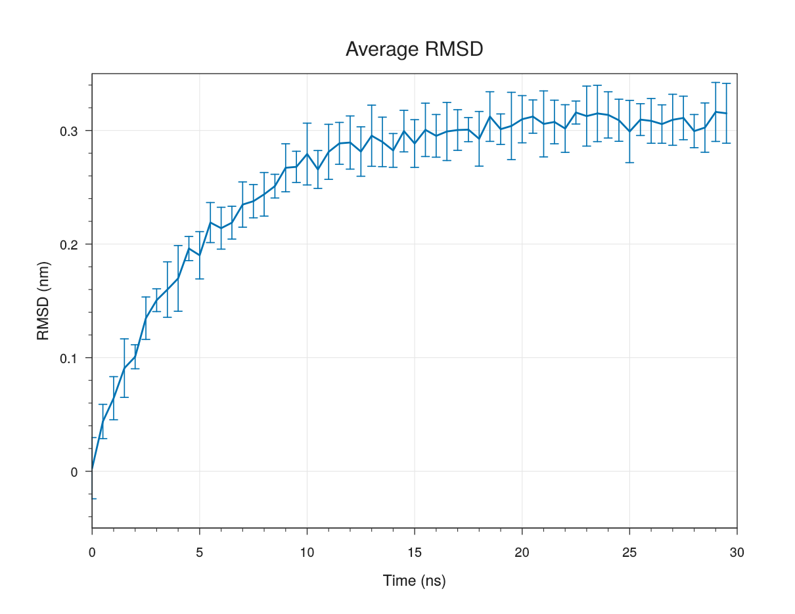
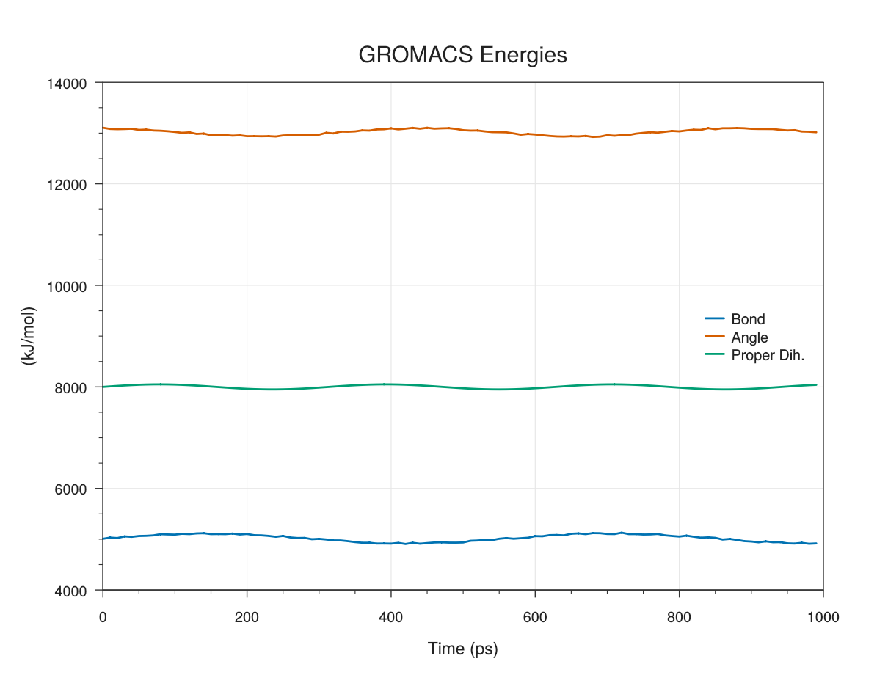

# GROMACS `.xvg` files

GROMACS analysis tools (`gmx rms`, `gmx energy`, `gmx gyrate`, `gmx analyze`, `gmx rdf` and many
others) write their results as `.xvg` files. These are text tables with xmgrace commands in front,
which set the title, axis labels, legends and set type. CactusPlot reads those commands, as
xmgrace does, and improves on xmgrace in a few places.

## Opening

Any of these works:

- double-click the `.xvg` file (the installers register the file type);
- drag it onto the CactusPlot window;
- **File ▸ Open**;
- from a terminal:

```bash
cactusplot rmsd.xvg
```

The file loads straight away, without the import dialog. You get:

| In the file | In CactusPlot |
|---|---|
| `@ title`, `@ subtitle`, `@ xaxis label`, `@ yaxis label` | Title, subtitle and axis labels. Grace escapes such as `\S2\N` (superscript) and `\xl\f{}` (Greek λ) are understood. |
| `@ s0 legend "..."`, `@ s1 legend "..."` | Legend entries. |
| `@TYPE xy` with more than two columns | One curve for each column. In xmgrace you would need `-nxy` for this. |
| `@TYPE xydy` | Error bars. The third column is the error in y. |
| `@TYPE xydy` with five columns (`x y1 dy1 y2 dy2`) | Two curves, each with error bars. |
| `@ view`, `@ legend 0.78, 0.8`, `@ legend box …` | Ignored in the modern styles, where the automatic layout gives a larger plot and puts the legend where it doesn't cover data. Kept in the Grace Classic style. |





## Comparing several runs

Drag several `.xvg` files onto the same plot, or give them all on the command line:

```bash
cactusplot run1/rmsd.xvg run2/rmsd.xvg run3/rmsd.xvg
```

All curves go into one graph. Curves without a legend are named after their file. Each file's
`s0`, `s1`, … commands apply to that file's own curves, so the second file does not overwrite the
legends of the first.

To put each run in its own panel instead, open the files, then use **Plot ▸ Arrange Graphs** and
move sets between graphs (see [Graphs and sets](graphs.md#several-graphs-on-a-page)), or script
it:

```bash
cactusplot -graph 0 run1/rmsd.xvg -graph 1 run2/rmsd.xvg -pexec "arrange(1, 2, 0.12, 0.3, 0.15)"
```

`arrange(rows, columns, margin, horizontal gap, vertical gap)` places the graphs; the gaps are
fractions of a graph's size. Stacked panels (`arrange(2, 1, …)`) need a vertical gap of about 0.7
when each graph has a title and subtitle, or remove the titles: `with g1; title ""; subtitle ""`.

## Making figures in batch

On a cluster or in a workflow, make a PDF without opening a window:

```bash
cactusbat rmsd.xvg -o rmsd.pdf
```

To restyle for a paper and label the axes from the command line:

```bash
cactusbat energy.xvg --style Publication --ylabel 'Energy (kJ mol$^{-1}$)' -o energy.pdf
```

To make figures for every file in a folder:

```bash
for f in *.xvg; do cactusbat "$f" -o "${f%.xvg}.pdf"; done
```

If you have no `cactusbat` command (macOS, Windows or the AppImage), use `cactusplot -hardcopy`
instead.

## The xmgrace look

To get the plot exactly as xmgrace would show it, with the GROMACS page layout, open the file and
choose **Plot ▸ Style Preset ▸ Grace Classic**, or from a terminal:

```bash
cactusplot --style "Grace Classic" rmsd.xvg
```

## Common follow-ups

| Task | How |
|---|---|
| Running average of a noisy RMSD | **Data ▸ Transformations ▸ Running statistics**, or `runavg(s0, 50)` in the Commands window |
| Distribution of values | **Transformations ▸ Histogram**, or `histogram(s0, mesh(0, 0.5, 51), off, on)` |
| Convert ps to ns | Commands window: `s0.x = s0.x / 1000`, then `xaxis label "Time (ns)"` |
| Average after equilibration (t > 5000 ps) | Commands window: `copy s0 to s1; restrict(s1, s1.x > 5000); avg(s1.y)`, or select the copy in **Data ▸ Statistics** |
| Fit an exponential to an autocorrelation | **Data ▸ Curve Fitting** with the *Exponential decay* model |
