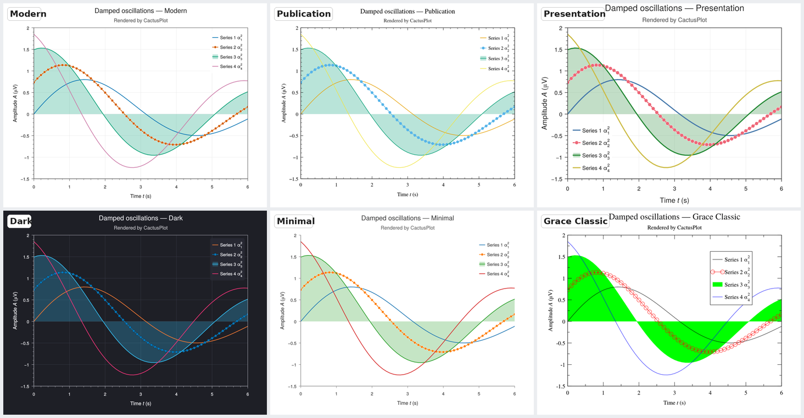
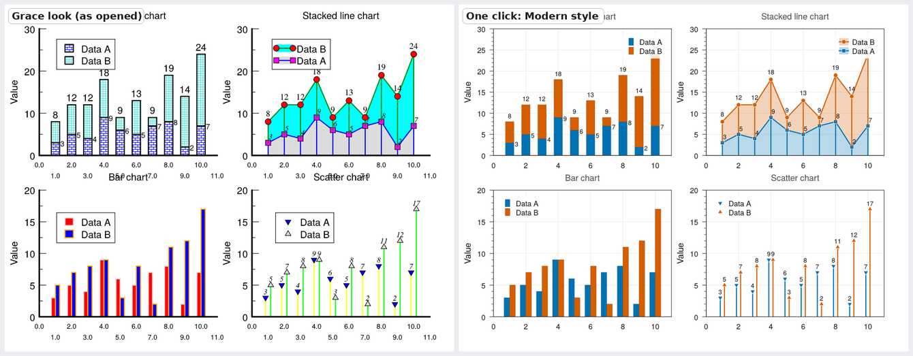

# Styles and colours

## Style presets

A style preset sets fonts, sizes, line widths, ticks, grid, legend and colours for the whole project
at once. Your data, text and layout are kept. Choose one with:

- **Plot ▸ Style Preset**, which restyles the open project;
- **File ▸ New with Style**, which starts a new project in that style;
- **Edit ▸ Preferences ▸ Style of new plots**, which sets the default;
- `--style "Name"` on the command line.



| Preset | Look |
|---|---|
| **Modern** (default) | Clean sans-serif look, light grid, colour-blind safe colours. Outward ticks, symbols with a contrasting edge, an automatically placed legend. |
| **Publication** | Serif fonts, inward ticks on all sides, no grid. Reads well in print and in greyscale. |
| **Presentation** | Large fonts and thick lines for slides and posters. |
| **Dark** | Light-on-dark styling for screens and dark slide themes, with a palette made for dark backgrounds. |
| **Minimal** | Open frame, no grid, understated axes. |
| **Journal (single column)** | Large relative text, for figures that will be shrunk to the width of one journal column. |
| **Grace Classic** | Reproduces the xmgrace default look. Grace projects (`.agr`) open in this style. |

> **Tip.** Restyling a Grace project is one click: open the `.agr` file and choose
> **Plot ▸ Style Preset ▸ Modern**.



## Colour palettes

**Plot ▸ Colour Palette** recolours every set from a palette, in order: set 0 gets the first colour,
set 1 the second, and so on. The 52 palettes include:

| Group | Palettes |
|---|---|
| **CactusPlot** | CactusPlot Modern (the default), CactusPlot Dark |
| **Colour-blind safe** | Okabe–Ito, Paul Tol's Bright, Vibrant, Muted, Light and High Contrast, IBM |
| **Classic** | Grace (the 15 Grace colours) |
| **Tableau / D3** | Tableau 10, 20, 20b, 20c |
| **ColorBrewer** | Set1, Set2, Set3, Pastel1, Pastel2, Paired, Accent, Dark2 |
| **Themes** | Solarized, Nord Aurora, Dracula, Gruvbox |
| **Glasbey (colorcet)** | Glasbey, Glasbey Light, Dark, Cool, Warm: up to 256 distinct colours for many sets |
| **Crameri categorical** | Categorical versions of the Scientific Colour Maps (batlowS, romaS, …) |

On the command line: `--palette "Okabe-Ito"`. To see them all: `cactusplot --list-palettes`.

## Colormaps

Colormaps turn a value into a colour. They are used by XYCOLOR sets (scatter plots coloured by a
third column) and drawn as colour bars. There are 158:

| Source | Examples |
|---|---|
| matplotlib | viridis, plasma, inferno, magma, cividis, turbo, coolwarm, twilight, jet, … |
| ColorBrewer | Blues, Greens, YlOrRd, RdBu, Spectral, PuOr, … |
| cmocean (oceanography) | cmo.thermal, cmo.haline, cmo.deep, cmo.balance, cmo.curl, … |
| Crameri Scientific Colour Maps | batlow, roma, vik, berlin, lajolla, oslo, hawaii, romaO, … |
| colorcet (CET) | cet.fire, cet.rainbow, cet.coolwarm, cet.bgy, cet.colorwheel, … |

Prefer **perceptually uniform** maps, such as viridis, cividis or the Crameri maps. They show
equal steps in value as equal steps in colour, and they still read correctly when printed in
grey. Use a **diverging** map (vik, RdBu, cmo.balance) for data with a meaningful middle value,
such as zero. Use a **cyclic** map (romaO, twilight, cmo.phase) for angles and phases.

To see them all: `cactusplot --list-colormaps`.

## The colour picker

Every colour button opens the picker. It has three tabs:

- **Palettes:** the palettes and colormap strips; click a swatch.
- **Named:** search about 1800 named colours by name. They come from CSS, X11, xkcd, Tableau and
  Grace, for example `tomato`, `steelblue`, `xkcd:dusty rose` or `grace:red`.
- **Custom:** a full colour editor with HSV, RGB and hex, and a screen colour picker.

Below the tabs are the **Recent** colours, an **Opacity** slider (CactusPlot supports
transparency everywhere, which Grace does not), and a **Transparent** button.

## Writing colours in commands

Wherever a command takes a colour, these forms work:

```
s0 line color "tomato"            # a name
s0 line color "#0072b2"           # hex
s0 fill color "#0072b280"         # hex with alpha (80 = half transparent)
s0 symbol color rgb(213, 94, 0)   # red, green, blue
s0 fill color rgba(0, 114, 178, 128)
s0 line color 2                   # a Grace colour number (2 = red)
```

To see every name: `cactusplot --list-colors`.

## Grace colour numbers

Grace numbers its colours 0–15: 0 white, 1 black, 2 red, 3 green, 4 blue, 5 yellow, 6 brown, 7 grey,
8 violet, 9 cyan, 10 magenta, 11 orange, 12 indigo, 13 maroon, 14 turquoise, 15 green4. CactusPlot
understands these numbers in commands and `.agr` files. Projects can define more numbered
colours (`map color 16 to (40, 40, 40), "charcoal"`), as in Grace. When a project is saved as
`.agr`, every colour is written to this numbered table, so xmgrace shows the same colours (without
transparency).

## Gradients and patterns

- **Gradients:** fills (under curves, bars, page background) can be a vertical, horizontal or
  radial gradient between two colours. Set them on the Fill tab of a set, or under Page ▸ Background.
- **Patterns:** Grace's 32 fill patterns are reproduced exactly. Pattern 0 is no fill, 1 is solid,
  and 2–31 are hatchings and dot screens.
