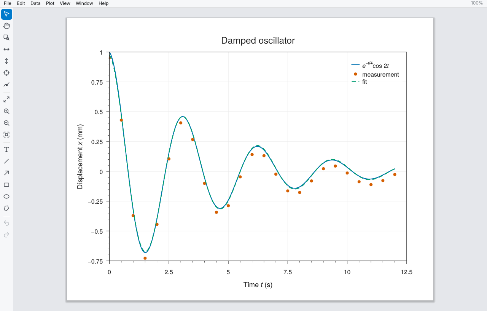
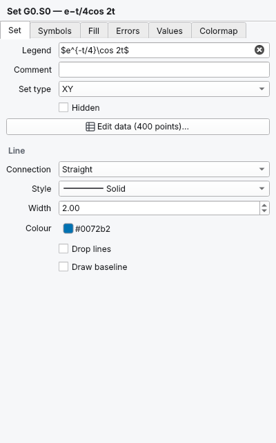
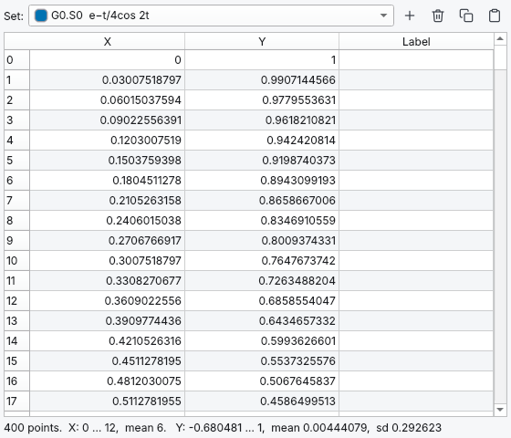
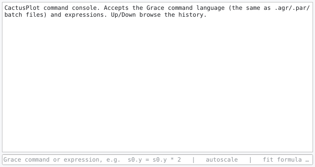
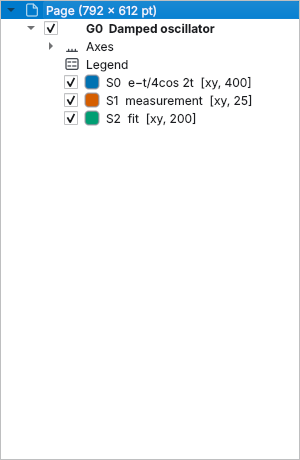

# The main window

CactusPlot keeps xmgrace's layout: the main window is the plot, a menu bar and a column of buttons.
Everything else opens in a separate window when you ask for it and stays out of the way otherwise.



## What you see

- **The page.** It is drawn exactly as it will be exported. Grey around the page is not part of the figure.
- **The menu bar.** On the right of the menu bar is the **locator**: the coordinates under the mouse,
  in data units of the graph under the cursor, and the current zoom of the page view.
- **The button column** on the left. From top to bottom:
  - the mouse tools (below);
  - **Autoscale**, **Zoom in**, **Zoom out** and **Fit page**;
  - the drawing tools;
  - **Undo** and **Redo**.

Hover over a button to see its name and keyboard shortcut.

## Mouse tools

| Tool | Key | What the mouse does |
|---|---|---|
| **Select** | V | Click an element to select it. Drag legends, titles and annotations to move them; arrow keys nudge them (Shift for bigger steps). Drag inside a graph to pan. |
| **Pan** | H | Drag to move the data range of the graph under the cursor. |
| **Zoom box** | Z | Drag a rectangle to zoom into it. A click zooms in by 2 around that point. |
| **Zoom X** / **Zoom Y** | Shift+X / Shift+Y | As Zoom box, but only along one axis. |
| **Crosshair** | C | Shows the coordinates and the nearest data point in the locator. |
| **Edit points** | P | Drag a data point to change it. **Ctrl+click** deletes a point, **Shift+click** adds one. |
| **Text** | T | Click where the text should go, then type. |
| **Line**, **Arrow** | L, A | Drag from start to end. |
| **Box**, **Ellipse** | B, E | Drag a rectangle. |
| **Region** | R | Click the corners of a polygon; double-click to close it. See [Annotations and regions](annotations.md). |

**Esc** returns to the Select tool.

These mouse actions work with any tool:

- **Mouse wheel** zooms the graph under the cursor. Hold **Shift** to zoom only x, **Alt** only y.
- **Ctrl+wheel** zooms the page view (the window, not the data).
- **Middle-button drag** pans.
- **Double-click** anything (a curve, an axis, the legend, a title, an annotation, an empty part of
  the page) to open its settings in the Appearance window.
- **Right-click** an element for its context menu: **Properties**, **Edit Data**, **Fit Curve…**,
  **Transform…**, **Hide** and **Delete**.

Every change made with the mouse can be undone with **Ctrl+Z**.

## The separate windows

Like xmgrace, CactusPlot puts settings and data in their own windows. They float above the main
window and remember where you left them.

### Appearance (Ctrl+Shift+P)

This window holds all the settings of the selected element: page, graph, set, axis, legend, title or
annotation. Changes apply as you make them. Select another element in the plot and the window
switches to it. The Grace names are in the **Plot** menu: **Plot Appearance…**,
**Graph Appearance…**, **Set Appearance…** and **Axis Properties…** open this window on that kind of
element. Every setting is described in [Changing the appearance](appearance.md).



### Set editor (Ctrl+D)

**Data ▸ Edit Set (Spreadsheet)…** shows the data of a set as a table. Choose the set at the top.

- Double-click a cell to change it.
- The buttons add rows, delete the selected rows, copy the selection and paste.
- Copy and paste work with spreadsheets and text editors. Pasting replaces the data from the
  selected row on.
- The **Label** column holds text attached to each point, used for annotated values and pie labels.
- The line at the bottom gives the number of points and the range, mean and standard deviation.



### Commands (Ctrl+K)

**Window ▸ Commands…** is a console for the Grace command language. Type a command and press Enter;
**Up** and **Down** recall earlier commands. Anything that works in a batch file works here, for
example:

```
s0.y = s0.y * 1000
xaxis label "Time (ms)"
runavg(s0, 5)
```

A bare expression prints its value: `avg(s0.y)` or `sqrt(2)`. See the
[Command language](../reference/command-language.md).



### Explorer

**Window ▸ Explorer** lists the page, its graphs, their axes, legend and sets, and the annotations.

- Tick boxes show and hide items.
- Clicking an item selects it.
- The right-click menu has:
  - **Make current**;
  - **Autoscale** and **Autoscale to this set**;
  - **Duplicate**;
  - **Hide** or **Show**;
  - **Delete**;
  - **Edit data…**;
  - **Properties**.



## Menus

| Menu | Contents |
|---|---|
| **File** | New, New with Style, Open, Open Recent, Save, Save As, Import Data, Import from Clipboard, Export, Export Again, Print, Quit |
| **Edit** | Undo, Redo, Copy Plot as Image, Copy Plot as SVG, Import from Clipboard, Preferences |
| **Data** | Import Data, Edit Set (Spreadsheet), Evaluate Expression / New Set, Transformations, Curve Fitting, Statistics, Regions, Commands |
| **Plot** | Plot/Graph/Set Appearance, Axis Properties, Autoscale (all, X, Y, all graphs), Add Graph, Add Inset Graph, Arrange Graphs, Graph Type, X Scale, Y Scale, Toggle Grid Lines, Toggle Legend, Style Preset, Colour Palette |
| **View** | Zoom In, Zoom Out, Fit Page, Show Regions, Tools, Theme |
| **Window** | Appearance, Set Editor, Commands, Explorer |
| **Help** | Documentation, Command Reference, Mouse and Keyboard, About |

On macOS, **Preferences**, **About** and **Quit** are in the **CactusPlot** application menu, as
usual for Mac programs.

## Preferences

**Edit ▸ Preferences** (**Ctrl+,**; **⌘,** on a Mac) holds these settings:

- **Theme:** follow the system, light or dark. **View ▸ Theme** changes it as well.
- **Use the platform's native widget style:** on, the controls look like the rest of your desktop;
  off, CactusPlot uses its own consistent style.
- **Style of new plots:** the preset used by **File ▸ New** and for data opened on its own.
- **Autosave every … min:** 0 turns autosave off. After a crash, CactusPlot offers to recover the
  autosaved project the next time it starts.
- **Recent files:** how many to keep in **File ▸ Open Recent**.
- **Safe mode for scripts in project files:** on by default. It stops commands inside projects from
  writing files.

## Undo

Every change can be undone, whether you made it in the plot, in a window, from a command or in a
transformation. Use **Ctrl+Z** to undo and **Ctrl+Shift+Z** (or **Ctrl+Y** on Windows) to redo.
The title bar shows `*` when the project has unsaved changes.
