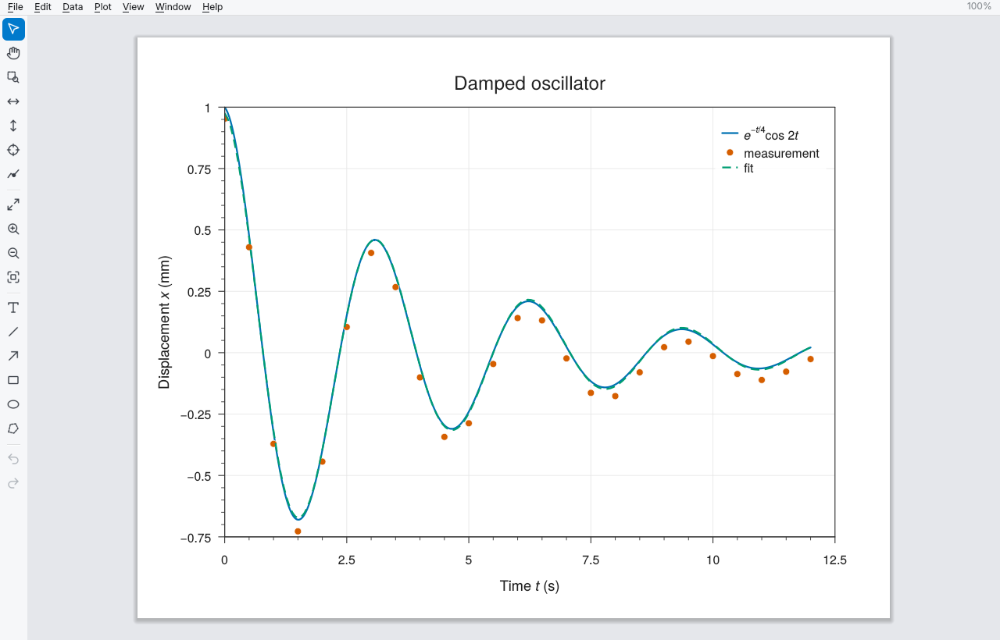

# CactusPlot documentation

CactusPlot is a 2D plotting program for scientists and engineers. It runs natively on Windows, macOS
and Linux. It follows the way xmgrace works: projects, batch scripts and command lines written for
Grace keep working. What it adds is a modern finish: figures look good without tweaking, everything
can be undone, and you get a large colour library.

## Start here

| If you want to… | Read |
|---|---|
| Install CactusPlot | [Installation](install.md) |
| Make your first plot in five minutes | [Tutorial](tutorial.md) |
| Plot GROMACS `.xvg` output | [GROMACS files](guide/gromacs.md) |
| Move over from xmgrace | [Coming from Grace](grace-migration.md) |
| Script figures from a terminal or a cluster | [Command line](reference/command-line.md) and [Command language](reference/command-language.md) |

## User guide

1. [The main window](guide/window.md): the plot, the button column, the menus and the separate windows
2. [Getting data in](guide/data.md): data files, the import dialog, the clipboard and the set editor
3. [GROMACS `.xvg` files](guide/gromacs.md)
4. [Graphs and sets](guide/graphs.md): set types, graph types, several graphs, insets
5. [Changing the appearance](guide/appearance.md): the Appearance window, page by page
6. [Styles and colours](guide/styles-colors.md): style presets, palettes, colormaps, the colour picker
7. [Axes and ticks](guide/axes.md): scales, tick spacing, label formats, dates
8. [Text and math](guide/text.md): `$TeX$` and Grace escapes
9. [Annotations and regions](guide/annotations.md)
10. [Data analysis](guide/analysis.md): expressions, transformations, curve fitting, statistics
11. [Exporting and printing](guide/export.md)

## Reference

- [Command-line options](reference/command-line.md)
- [Command language](reference/command-language.md)
- [Functions in expressions](reference/functions.md)
- [Set types, symbols and lines](reference/set-types.md)
- [File formats](reference/file-formats.md)
- [Mouse and keyboard](reference/shortcuts.md)

## More

- [Frequently asked questions and troubleshooting](faq.md)
- [Building, architecture and contributing](development.md)

## Words used in this documentation

A **project** is one **page**. A page holds one or more **graphs**, and each graph holds **sets**.
A set is a table of columns (X, Y, and maybe error bars or other values); its **set type** says how
the columns are used. **World** coordinates are data values. **Viewport** coordinates place
things on the page: the shorter side of the page has length 1. These are Grace's terms. They are
explained further in [Graphs and sets](guide/graphs.md).
